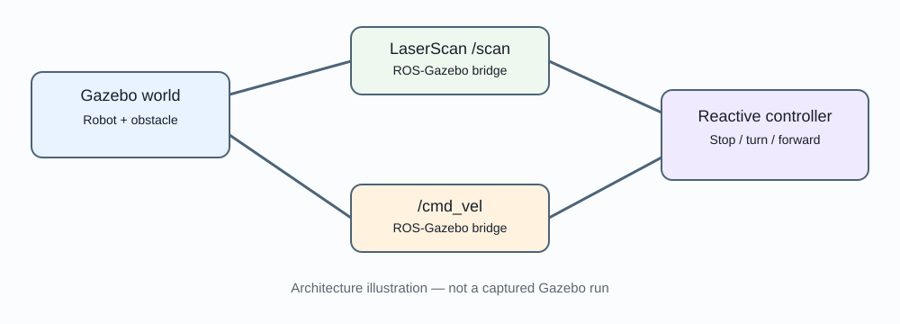

# ScoutNav Sim-to-Real

ROS 2 differential-drive simulation and a simple reactive controller. Target platform: **Ubuntu 24.04 LTS, ROS 2 Jazzy, Gazebo Harmonic**. Install the ROS/Gazebo integration packages from the official Jazzy documentation. This repository is source-complete but is not represented as executed in the user's environment.

## Simulation architecture preview



This is an architecture illustration, not a screenshot of a running Gazebo/RViz session. Add actual screenshots only after validating the simulation in Ubuntu 24.04 with ROS 2 Jazzy.

## Packages
- `scoutnav_controller/`: Python node subscribing to `/scan` and publishing `/cmd_vel`.
- `scoutnav_description/`: URDF/Xacro robot model, wheel geometry and sensor.
- `scoutnav_bringup/`: launch file and Gazebo world.
- `tests/`: host-side policy tests that do not require ROS.

## Build
```bash
source /opt/ros/jazzy/setup.bash
sudo apt update
sudo apt install ros-jazzy-ros-gz ros-jazzy-xacro python3-colcon-common-extensions
cd scoutnav-sim-to-real
rosdep install --from-paths . --ignore-src -r -y
colcon build --symlink-install
source install/setup.bash
python3 -m unittest discover -s tests -v
```

Launch:
```bash
ros2 launch scoutnav_bringup sim.launch.py
```

ROS/Gazebo package details can evolve. If `gz_ros2_control` or controller packages are missing, install the matching Jazzy packages from official repositories and validate the launch. The simulation model uses a Gazebo ROS 2 control plugin; controller spawner and topic-bridge configuration may need adjustment to match the installed package versions.

## Controller
The node considers a forward ±45° laser scan sector. If the minimum valid range is under the stop threshold, it rotates in place; otherwise it drives forward. If scan data is invalid or stale, it commands zero velocity. This is a baseline reactive controller, not SLAM, global path planning or a certified safety function.

## Sim-to-real protocol
1. Record world, dimensions, wheel radius/separation, sensor rates and controller parameters.
2. Verify spawn, scan validity, stop behavior and obstacle response in simulation.
3. Bring up physical ScoutNav with wheels raised and low speed.
4. Compare turning direction, sensor range, response delay and stopping distance.
5. Tune only after recording repeatable evidence. Keep hardware and simulation parameters separately documented.

## Interfaces
- Input `/scan` (`sensor_msgs/msg/LaserScan`)
- Output `/cmd_vel` (`geometry_msgs/msg/Twist`)
- `base_link`: +X forward, +Y left, +Z up.
- Hardware firmware must retain local e-stop and sensor fault protection.

## Limitations
Simplified geometry and friction; no calibrated motor dynamics, wheel slip, battery sag, localization or map. Gazebo lidar does not reproduce all HC-SR04 failure modes. A hardware bridge/adapter is not included as an automatic connection.
